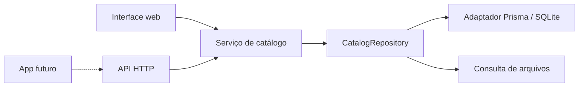

# Arquitetura inicial — decisões revisáveis

Status: primeiro incremento. O objetivo é permitir mudanças de produto sem reescrever toda a aplicação. Não existe compromisso com uma arquitetura final nem com uma tecnologia mobile neste momento.

## 001 — Uma aplicação, fronteiras pequenas

Next.js reúne site e API. Não há microserviços, monorepositório, barramento de eventos ou sistema de plugins. O serviço de catálogo depende de `CatalogRepository`, não de React, Next.js ou Prisma. A composição escolhe o adaptador; as páginas e rotas usam o serviço.

O adaptador de arquivos é um modo explícito de autoria, não fallback de falhas. Isso também permite testar se o contrato está independente da persistência. A API e as páginas compartilham os mesmos casos de uso; o site não faz uma requisição HTTP para si mesmo.

Reavaliar quando um segundo cliente real exigir implantação separada. Só extrair um pacote compartilhado quando houver um consumidor concreto.

## 002 — Conteúdo como dado

Cada disciplina é um JSON versionado, validado por Zod. A estrutura é disciplina → módulo → tópico → plano de aula e atividades. Não há enumeração de disciplinas no código. Categorias e cores pertencem a vocabulários pequenos e podem ser estendidos conscientemente; não identificam regras de uma linguagem.

`schemaVersion` representa o formato do arquivo; `version` representa a revisão curricular. `orderIndex` ordena disciplinas; a ordem dos arrays ordena módulos e tópicos. Os pré-requisitos apontam para IDs globais e podem atravessar disciplinas. A validação rejeita referências ausentes e ciclos. Por enquanto são recomendações de percurso, não bloqueios de acesso.

O status `PLANNED` significa somente planejamento. Não usar esse contrato como schema de uma aula pronta. Na próxima entrega, `LessonSchema` e `ExerciseSchema` serão contratos próprios, com versões, estados editoriais e dados privados separados.

## 003 — Persistência substituível

Prisma 6.19.3 e SQLite foram escolhidos conforme o documento-base, com versões fixadas no lockfile. Atualizações de versão são tarefas próprias, com migração e testes. O banco tem tabelas relacionais para disciplina, módulo e tópico; campos pedagógicos ainda variáveis ficam em JSON validado, sem criar agora tabelas para funcionalidades futuras.

Migrações são versionadas. O seed é aditivo, transacional e repetível: atualiza pelo ID e não apaga dados locais. Uma futura remoção ou mudança de identificador exige análise de impacto e migração explícita. Não usar exclusão e recriação como mecanismo de atualização.

IDs do catálogo são legíveis e derivados de slugs. Após existir progresso, tratá-los como identidades persistentes. Reorganizar um tópico entre módulos preserva seu ID; mudar disciplina ou slug exige migração. O catálogo inicial ainda não armazena tentativas ou progresso.

## 004 — Site agora, aplicativo depois

Contratos públicos são serializáveis e não exportam modelos Prisma. Regras de correção e revisão, quando implementadas, devem ser funções puras em `src/lib/pedagogy`. A interface móvel poderá consumir a API e, quando fizer sentido, compartilhar contratos e regras TypeScript. Componentes DOM e CSS não são considerados compartilháveis automaticamente.

Não se escolheu React Native, Expo ou PWA. Antes do app, decidir: plataformas, estudo offline, autenticação, serviço remoto, armazenamento persistente e resolução de conflitos. A existência de uma API hoje não significa que sincronização já esteja resolvida. SQLite local é adequado ao começo; hospedagem com disco efêmero exige outra estratégia de persistência.

## 005 — Segurança e correção pedagógica

Não há autenticação no uso pessoal inicial. Exposição a usuários externos e sincronização precisam de uma decisão de acesso antes de serem entregues. Não há chaves ou chamadas a IA nesta versão.

As respostas públicas atuais contêm apenas o plano curricular. Futuramente, `solutionJson`, notas privadas do tutor e respostas-modelo não podem ser carregados junto ao exercício antes da etapa permitida. Validação no servidor e correção determinística são responsabilidades de domínio, não decisões dos componentes.

Todo código gerado e todo código do aluno que precisar ser executado exigirá ambiente isolado apropriado; não implementar execução usando `eval` ou subprocesso sem isolamento no servidor web.

## Como mudar uma decisão

Registrar a motivação, os consumidores afetados, a migração de dados necessária e os testes que demonstram a nova regra. Uma decisão inicial pode ser substituída. A estabilidade mais importante é a integridade do conteúdo e do histórico de aprendizagem, não a permanência de uma biblioteca.
